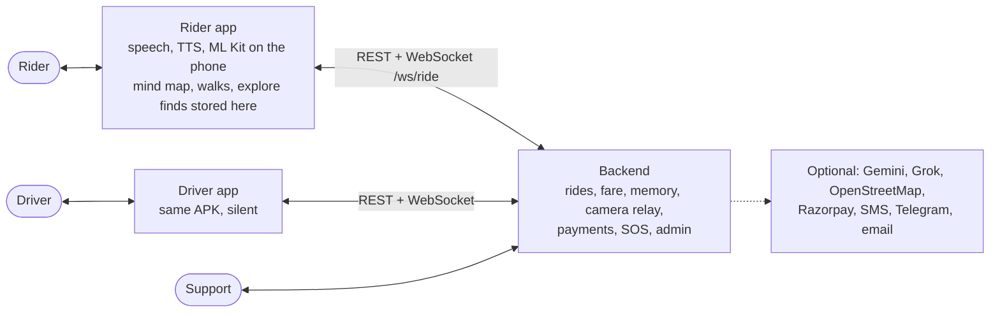

# Cab Eye

**A voice-first cab app for blind and low-vision riders, built for Coimbatore.**

A blind rider holds the screen and says *"take me to PSG Tech"*. Cab Eye books an auto or a
cab, narrates the driver's approach in tones, checks the right car with a boarding code the
**driver** says, guides the ride, and takes payment and feedback, all by voice. Off the cab,
the rider can point their camera at the street and hear what is in front of them, and
everything they learn builds a personal **mind map** of their city.

The interface is **audio**: speech, earcons and vibration. The screen repeats everything in
large high-contrast type for low-vision riders and sighted helpers, and every voice feature
also has a button. The rule behind the whole build: **the rider is blind, so silence must
always mean something.**

---

## Contents

1. [The three modules](#the-three-modules)
2. [How the rider controls it](#how-the-rider-controls-it)
3. [What's in the project](#whats-in-the-project)
4. [Quick start](#quick-start)
5. [Optional keys](#optional-keys)
6. [Demo accounts and data](#demo-accounts-and-data)
7. [Testing](#testing)
8. [Documentation](#documentation)

---

## The three modules

| Module | What it is | Opens with |
|---|---|---|
| **Rides** | Book by voice, the driver's approach in tones, position presets and an audio beacon, the reversed boarding code, the **ride camera** (the driver can ask to see the rider's camera; the rider hears the objects around them), a ride guide that names areas and the rider's own cues, multi-stop rides, server-side fare from GPS, payment, feedback, scheduling. | Hold the screen and speak |
| **Explore** | No ride needed. The rider walks around their place with the camera; Cab Eye describes what's ahead (hazards first, clock positions, distances), keeps telling them what's new, finds things ("find the door"), reads text, and remembers named spots. What it sees goes into the mind map, and the walk is saved. | **Double tap** the screen |
| **Mind map** | Everything the rider knows, with separate storage for rides and walks. **From my rides**: destinations, cues, areas, saved routes. **From my walks**: named spots, camera finds, walks, notes. **Map**: a radar around the rider. Book a ride or start walk guidance from any card. | **Volume down three times** |

Around them:
- **Memory agent**: learns habits and offers "Going to PSG College, like most weekday
  mornings?". It repairs misheard names and learns the rider's own words.
- **Walking routes**: "the last hundred metres" from the kerb to the door.
- **Driver app**: the same APK in driver mode, silent.
- **Admin website**: cases, SOS alerts to Telegram and email.

## How the rider controls it

The microphone **never opens by itself**: it listens only while the rider holds the screen or a
volume key.

| Input | Does |
|---|---|
| **Hold anywhere** on the screen, or **hold a volume key** | Talk (let go to finish) |
| **Short press** of a volume key | Volume up / down |
| **Double tap** the screen | Open **Explore** (camera) |
| **Volume down three times quickly** | Open / close the **Mind map** |
| **Tap**, in the cab | "Where are we" |
| **Hold SOS** 2 s (main screen, Explore, mind map) | Sends an urgent case with your location to support, and says whether it got through |
| Top bar: **⚙ Settings**, **📷 Explore**, **🧭 My mind map** | The same, by touch or TalkBack |

Say **"help"** at any time for the list of commands. The full guide, with every voice command
in every module, is [docs/RIDER-GUIDE.md](docs/RIDER-GUIDE.md).

## What's in the project

```
cab_eye/
├─ README.md                ← you are here
├─ docs/                    ← all other documentation (see below)
├─ android/                 ← the phone app: rider + driver (Kotlin, Jetpack Compose)
│  └─ app/src/main/java/com/cabeye/rider/
│     ├─ RiderViewModel.kt  ← the rider's dialogue and every module's flow
│     ├─ MainActivity.kt    ← one Activity: role switch, permissions, volume keys
│     ├─ ui/                ← RiderSurface (main screen + gestures), ExploreScreen, MindMapScreen
│     ├─ explore/           ← explore module
│     ├─ vision/            ← SceneDetector (Gemini via backend, ML Kit on device), SceneSpeech
│     ├─ camera/            ← CameraStreamer: one camera for ride camera, explore and preview
│     ├─ mindmap/           ← mind map graph, store (rides / explore), agent, ride guide, catalog
│     ├─ memory/            ← ride preference-memory agent
│     ├─ walk/              ← walking routes (record, narrate, guide)
│     ├─ audio/ speech/     ← TTS, earcons, panned beacon, on-device speech recognition
│     ├─ intent/ places/    ← intent parsing, Google Places, offline Coimbatore atlas
│     ├─ net/               ← REST + WebSocket client
│     ├─ driver/            ← driver app
│     └─ auth/ trip/ schedule/ security/ …
├─ backend/                 ← Spring Boot server (Java 17)
│  ├─ cabeye-secrets.example.properties  ← copy to cabeye-secrets.properties for keys
│  └─ src/main/java/com/cabeye/backend/  ← rides, auth, memory, fare, camera, vision (Gemini), …
├─ scripts/                 ← demo data, history seeding, atlas builder, load test
├─ run-backend.ps1          ← start the backend (finds a Java 17+ by itself)
├─ install-app.ps1          ← build + install on every connected phone
├─ share-with-friends.ps1   ← ngrok tunnel + an APK that already knows the address
├─ docker-compose.yml, docker/, aws/   ← multi-instance and cloud deployment
```



Every level of detail, from this overview down to each flow and where every piece of data
lives, is drawn in **[docs/ARCHITECTURE.md](docs/ARCHITECTURE.md)**: system context,
containers, phone and server components, the ride lifecycle on both sides, sequence diagrams
for booking, reconnecting, explore, the ride camera and SOS, input routing, and data and
privacy.

## Quick start

Details, phone preparation and troubleshooting: [docs/SETUP.md](docs/SETUP.md).

1. **Backend:** right-click `run-backend.ps1` → *Run with PowerShell*. Wait for
   `Started CabEyeBackendApplication`; check <http://localhost:8080/health>.
2. **App:** plug in the phone (USB debugging on), right-click `install-app.ps1` → *Run with
   PowerShell*. It builds, installs, tunnels `localhost:8080` to the phone and launches the app.
3. **On the phone:** allow the microphone, location and notifications. Sign in by saying your
   number (in demo mode the code fills itself in). Then hold the screen and say *"take me to
   Gandhipuram"*.
4. **Driver (second phone):** ⚙ Settings → **DRIVER** → sign in → **GO ONLINE** → accept the
   request.

Building by hand needs Java 17+; this PC's default Java is 11, so set
`JAVA_HOME="C:\Program Files\Android\Android Studio\jbr"` first:

```powershell
cd backend;  .\gradlew.bat bootRun                   # backend
cd android;  .\gradlew.bat installDebug              # app
```

To give the app to someone not on your cable, use `share-with-friends.ps1`
([docs/SETUP.md#4-share-with-someone-else-ngrok](docs/SETUP.md#4-share-with-someone-else-ngrok)).

## Optional keys

Nothing needs a key to run. Each key adds a feature:

| Key | Where | Adds | Without it |
|---|---|---|---|
| `cabeye.gemini.api-keys` (several, comma-separated) | `backend/cabeye-secrets.properties` | Gemini scene descriptions: better names, distances, hazards, reading | ML Kit on the phone |
| `cabeye.grok.api-key` | same | Grok as the mind map's sentence reader | Gemini, else rules only |
| `cabeye.admin.*`, `cabeye.telegram.bot-token`, `spring.mail.*` | same | Admin login, SOS / urgent alerts | No admin login, no alerts |
| `cabeye.razorpay.*` | same | Real payments | Mock gateway |
| `cabeye.sms.twilio.*` / `cabeye.sms.fast2sms.api-key` | same | Real SMS codes | Code shown in the app |
| `GOOGLE_MAPS_API_KEY` | `android/local.properties` | Google Places search, map preview | Offline Coimbatore atlas |

Start from `backend/cabeye-secrets.example.properties` and `android/local.properties.example`.
Restart the backend after changing secrets. It logs `GEMINI keys=N models=[…]` at start-up.

## Demo accounts and data

`scripts/seed_demo.py` creates two accounts on the **local** backend with a history:

| | Number | |
|---|---|---|
| Rider **Meena** | 90000 11111 | Emergency contact Priya. 4 weeks of rides: college on weekday mornings, pharmacy-then-college on Mondays, KG Hospital on Saturdays, "pick up Amma" on Wednesdays, the mall on Sundays. Saved routes "Monday errands" and "Fetch Amma". |
| Driver **Karthik** | 90000 22222 | Bajaj RE auto, TN 37 BX 4412. Three completed rides with Meena (GPS distance, fare, paid, ratings both ways, one safety complaint on the admin site). |

```powershell
$env:CABEYE_MEMORY_SIMULATOR = "true"; .\run-backend.ps1
python scripts\seed_demo.py
```

Then on the phone: Settings → Sign out → sign in as 90000 11111. In debug builds, Settings →
**Load demo walks & mind map** adds the phone-only half: three walks with landmarks, personal
notes (Ravi's tea shop, the temple bell, where Meena meets Priya), ride cues, areas and past ride
paths. That gives the mind map something to show at once.

In a debug build, say **"simulate a ride to Koniamman Temple"** to play a whole ride through the
ride guide without a cab.

## Testing

```powershell
cd backend;  .\gradlew.bat test                      # endpoint + logic tests, no network needed
cd android;  .\gradlew.bat testDebugUnitTest         # dialogue, agents, vision, walks, mind map
```

External services (Gemini, Grok, OpenStreetMap, SMS, Razorpay) are stubbed in tests.

**See every screen without a phone.** This renders all rider screens, in all three themes, to
PNG files in `android/app/build/screenshots/`, plus contact sheets:

```powershell
cd android;  .\gradlew.bat :app:testDebugUnitTest --tests "*ScreenGalleryTest" -Pscreenshots
```

Step-by-step checks on real phones, feature by feature: [TESTING-NEXT-PHASE.md](TESTING-NEXT-PHASE.md).

## Documentation

| Document | Covers |
|---|---|
| [docs/ARCHITECTURE.md](docs/ARCHITECTURE.md) | Diagrams at every level: context, containers, components, ride lifecycle, flows, input routing, data and privacy |
| [docs/RIDER-GUIDE.md](docs/RIDER-GUIDE.md) | Every input and voice command: sign-in, rides, explore, mind map, walks, settings, TalkBack, the driver app, the admin site |
| [docs/SETUP.md](docs/SETUP.md) | Installing, running, phones, `adb reverse`, sharing with ngrok, logs, troubleshooting, versions |
| [docs/EXPLORE-AND-CAMERA.md](docs/EXPLORE-AND-CAMERA.md) | Explore, the ride camera, Gemini + ML Kit detection, what is stored |
| [docs/MIND-MAP-AGENT.md](docs/MIND-MAP-AGENT.md) | The mind map: graph, ride/explore storage, the screen, ride guide, nearby places, offline atlas, OSM, sentence reader |
| [docs/WALKING-ROUTE-AGENT.md](docs/WALKING-ROUTE-AGENT.md) | Recording and guiding walks |
| [AGENT-ARCHITECTURE.md](AGENT-ARCHITECTURE.md) | The ride preference-memory agent |
| [docs/BACKEND.md](docs/BACKEND.md) | Backend packages, every endpoint, WebSocket events, configuration |
| [docs/FARE-AND-FEEDBACK.md](docs/FARE-AND-FEEDBACK.md) | GPS km, server-side fare, feedback both ways |
| [docs/GOOGLE-PLACES.md](docs/GOOGLE-PLACES.md) | Google Places + Maps integration |
| [docs/DESIGN-DECISIONS.md](docs/DESIGN-DECISIONS.md) | Why it is built the way it is |
| [TESTING-NEXT-PHASE.md](TESTING-NEXT-PHASE.md) | On-device test scripts |
| [DOCKER_SETUP.md](DOCKER_SETUP.md), [aws-docker-setup.md](aws-docker-setup.md) | Docker cluster (PostgreSQL, Redis, Nginx) and AWS |
| `docs/Cab-Eye-Gist.docx` | Project summary document |
