# Architecture

[← Back to the README](../README.md)

Cab Eye, drawn at increasing levels of detail. Each level zooms into one box of the level
above it: the system in its world, then its deployable parts, then the components inside the
phone app and the server, then how a ride moves, the main flows step by step, how input is
routed, and where every piece of data lives.

The diagrams are [Mermaid](https://mermaid.js.org/). GitHub and most Markdown viewers draw
them; anything else shows their source, which is written to be readable too.

| Level | Diagram | Answers |
|---|---|---|
| 1 | [System context](#1-system-context) | Who uses Cab Eye, and what it talks to |
| 2 | [Containers and deployment](#2-containers-and-deployment) | What runs where |
| 3 | [Phone app components](#3-phone-app-components) | How the app is put together |
| 3 | [Backend components](#4-backend-components) | How the server is put together |
| 4 | [Ride lifecycle](#5-ride-lifecycle) | Every state a ride passes through, on both sides |
| 4 | [Flows](#6-flows) | Booking to pickup, reconnecting, explore, ride camera, SOS |
| 4 | [Input routing](#7-input-routing) | What each touch and key press does |
| 4 | [Data and privacy](#8-data-and-privacy) | What is stored where, and what leaves the phone |

---

## 1. System context

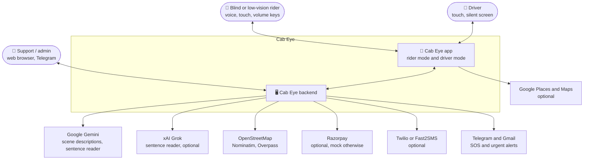

Every external service is optional. With no keys at all, the app books rides, describes the
camera with its on-device detector, finds places in its offline Coimbatore atlas, takes mock
payments and shows sign-in codes on screen.

---

## 2. Containers and deployment

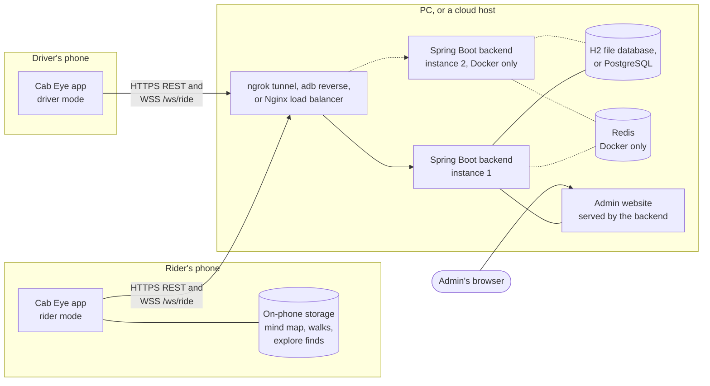

| Setup | How phones reach the server | Data |
|---|---|---|
| **USB** (`install-app.ps1`) | `adb reverse` maps the phone's `localhost:8080` to the PC | H2 file in `backend/data/` |
| **Any phone** (`share-with-friends.ps1`) | ngrok gives the PC a public `https://` address, baked into the APK | H2 file |
| **Docker cluster** (`docker-compose.yml`) | Nginx in front of two backend instances | PostgreSQL; Redis shares ride events between instances |
| **AWS** (`aws/`) | Load balancer in front of containers | PostgreSQL, Redis |

---

## 3. Phone app components

One APK, one Activity. The role (rider or driver) picks the root screen; there is no
navigation stack.

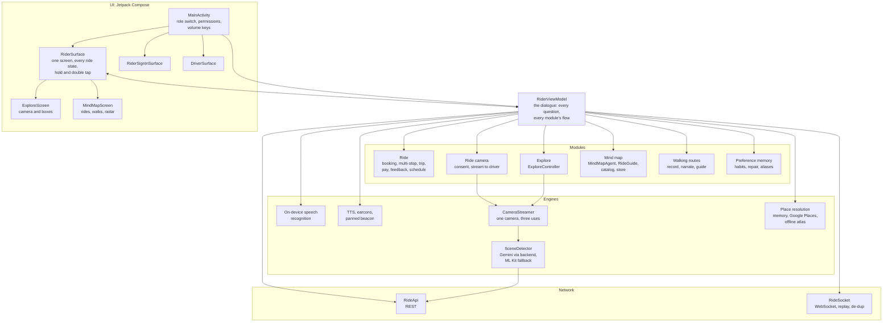

The surface is deliberately thin: it shows `RiderUiState` and reports touches. Every
decision (what a press means now, what to say, whether the mic may open) is made in
`RiderViewModel`, which is why the dialogue can be unit-tested on the JVM.

---

## 4. Backend components

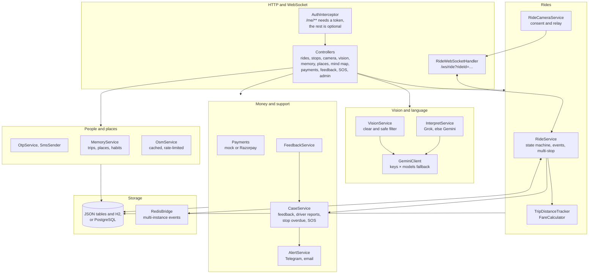

---

## 5. Ride lifecycle

The server owns the ride (`RidePhase`). The rider's phone shows its own, finer states
(`RiderState`), several of which exist only on the phone: listening, clarifying, the
five-second cancel window, and the post-ride questions.

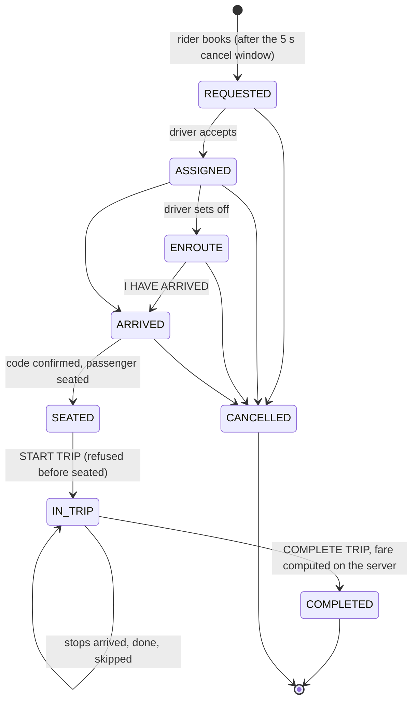

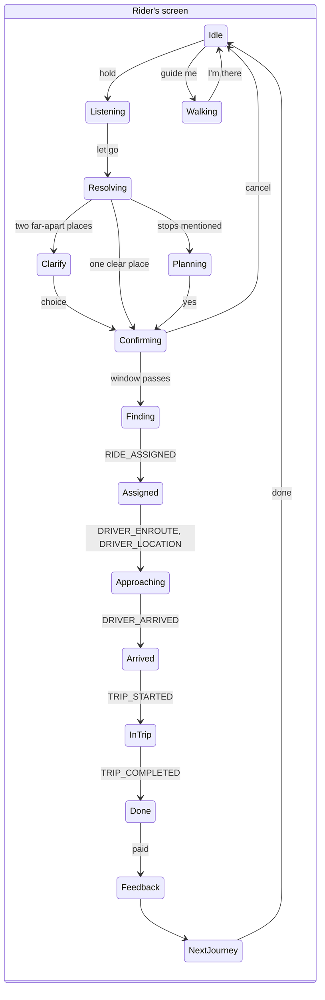

SOS, the ride camera, explore and the mind map are **overlays**, not states: raising one never
loses the ride state underneath, and closing it returns the rider exactly where they were. The
mind map closes by itself if the ride moves on underneath it.

---

## 6. Flows

### Booking to pickup, with the boarding code running backwards

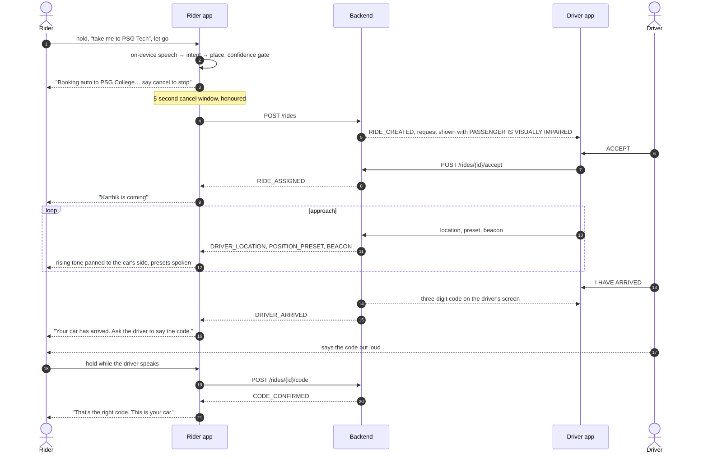

The rider's phone never announces the code: a blind person on a street can't tell who is
listening. With headphones in, it whispers the expected code through the earpiece first.

### Losing and regaining the connection

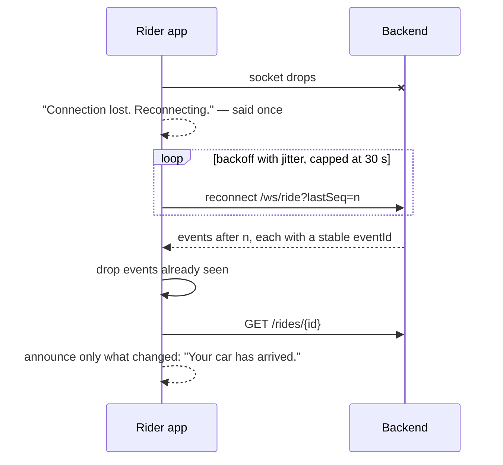

### Explore: "what's in front of me"

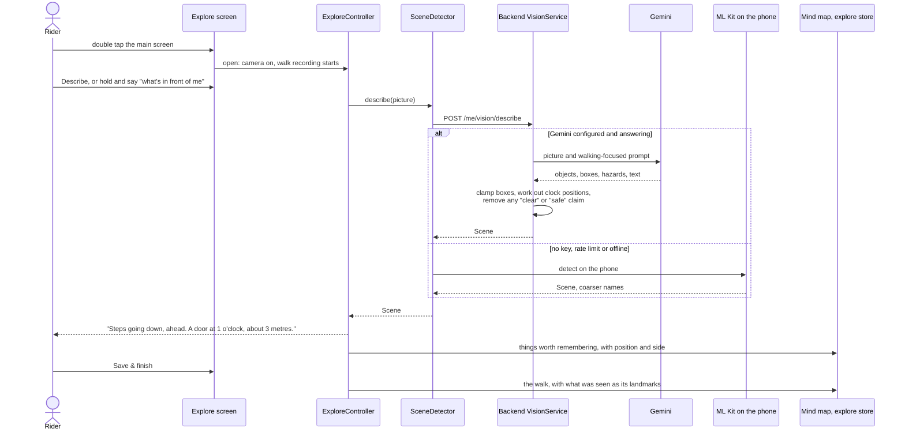

### The ride camera

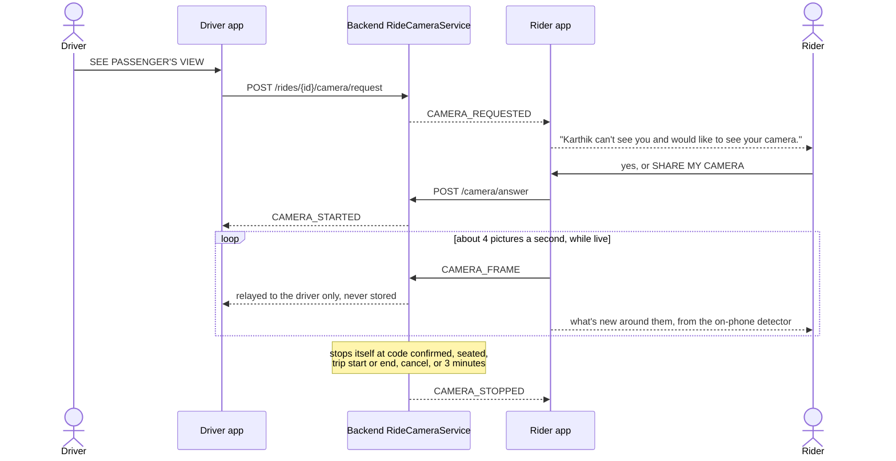

### SOS

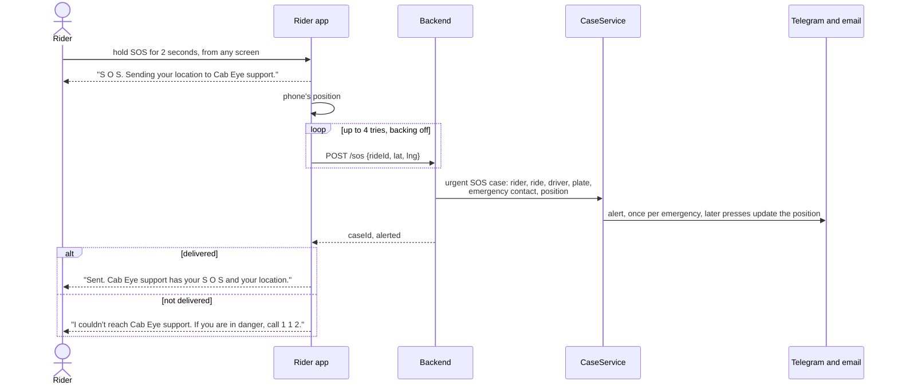

The app says only what actually happened. A guest, or a rider whose session expired, still
gets through.

---

## 7. Input routing

The microphone opens only while the rider presses. One flowchart for every input:

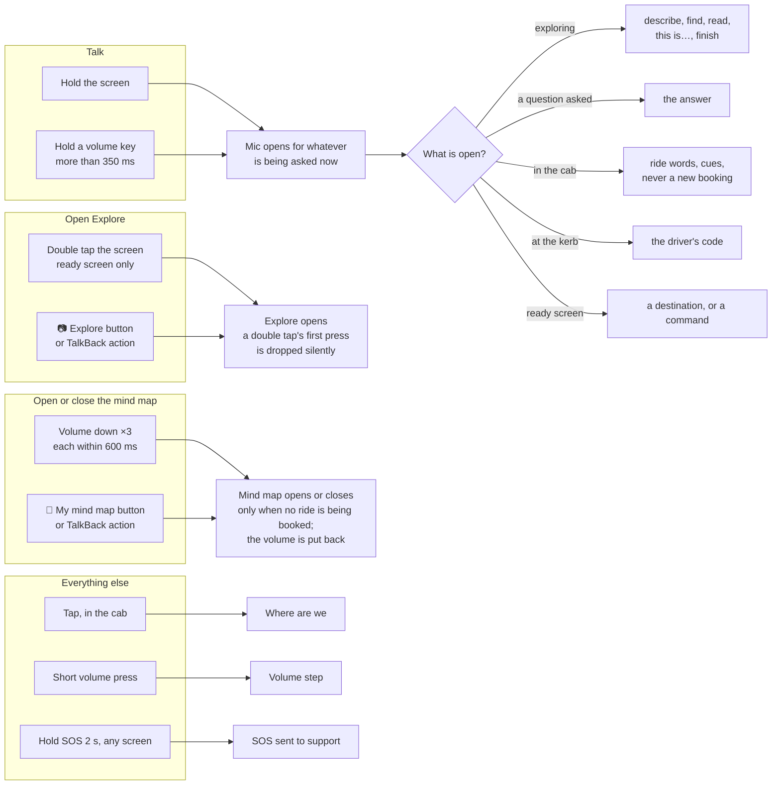

---

## 8. Data and privacy

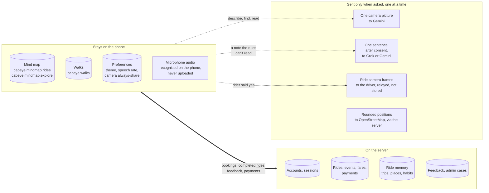

| Data | Where | Why there |
|---|---|---|
| Speech | The phone's recogniser | Seconds matter, and audio is private |
| Mind map, walks, camera finds | The phone (SharedPreferences) | The rider's own map of their life; nothing to gain by uploading it |
| Ride memory (habits, places) | Server, per account | Survives a new phone; powers "like most weekday mornings" |
| Rides, fares, payments, feedback | Server | Shared between rider, driver and support |
| Camera pictures | Nowhere | Described or relayed, then forgotten |
| OSM lookups | Server cache | Positions rounded to ~11 m, IPs not passed on, cached to respect OSM's limits |

---

## How it's checked

| Layer | Tests |
|---|---|
| Dialogue, agents, parsers | Android JVM tests (`gradlew testDebugUnitTest`): booking dialogue, memory agent, walks, mind map, ride guide, vision and explore, distance display |
| Every screen, every theme | `ScreenGalleryTest` renders all rider screens in all three themes to PNG, no phone needed (`-Pscreenshots`) |
| Server | Spring Boot endpoint tests (`gradlew test`): rides, multi-stop, fare, camera, vision, memory, OSM, payments, SMS, admin, SOS; external services stubbed |
| Real phones | [TESTING-NEXT-PHASE.md](../TESTING-NEXT-PHASE.md) |
